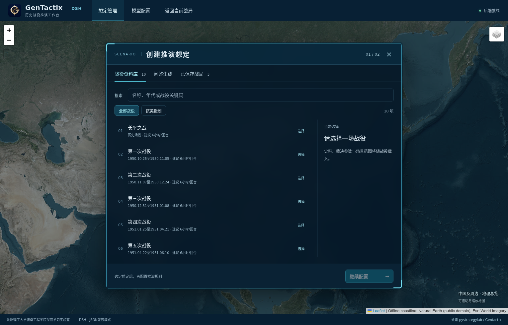
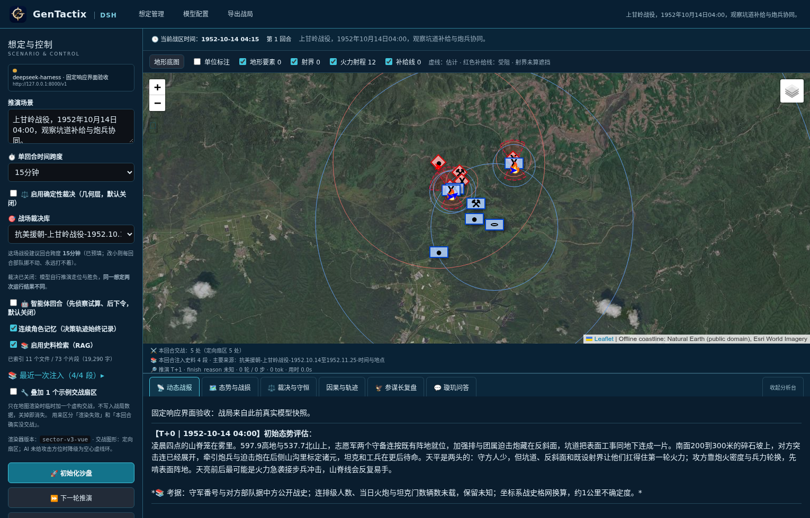

# GenTactix-DSH

[简体中文](README.md) | **English**

A desktop workspace for historical campaign simulation and decision review. Built with Vue 3, Electron, FastAPI and DeepSeek Harness (DSH), it brings historical sources, map-based state, turn progression and decision traces together for teaching, scenario discussion and software research.



## Features

- **Campaigns and scenarios:** start with a map of China and its surroundings. Choose the Battle of Changping or one of nine Korean War campaigns, or create a scenario through a guided conversation.
- **Map and state:** display units, movement trails and status. When data is available, show terrain features, fields of fire, weapon ranges, supply nodes and routes, and personnel/equipment losses. Missing values remain unknown.
- **Turn progression:** select the turn duration and let the application maintain the clock. State checks preserve the roster and flag missing units, invalid coordinates and numeric anomalies. Optional geometric adjudication constrains movement, supply connectivity and encirclement.
- **DSH agents and plugins:** Native tool mode supports persistent role sessions, read-only domain tools, runtime events, budgets and in-flight cancellation. An application-level JSON tool mode remains available for compatibility.
- **Decision review:** inspect reports, key decisions and turning points; use traces for attribution analysis. Geometric counterfactuals and paired model branches leave the main campaign state intact.
- **Sources and saves:** local historical retrieval, campaign-specific adjudication parameters, checkpoints, recovery and JSON import/export.
- **Model settings:** configure vLLM / OpenAI-compatible or DeepSeek endpoints, models, credentials, timeouts and role budgets through the menu. Settings are stored encrypted.



## Install and launch

Download a Linux x86_64 package from [Releases](https://github.com/snow-wind-001/Gentactix-DSH/releases). Packages include the backend and DSH runtime; a separate Python or Conda installation is unnecessary. Simulations still require a working model service.

| Package | Usage |
| --- | --- |
| Ubuntu `.deb` | Install with the system installer or `sudo apt install ./GenTactix-DSH-<version>-amd64.deb`, then find **GenTactix** in the applications menu |
| `.AppImage` | Make executable and double-click; use `APPIMAGE_EXTRACT_AND_RUN=1` when FUSE is unavailable |
| `.tar.gz` | Extract and run `gentactix-dsh` |

From a source checkout, install an AppImage with a per-user menu entry and desktop icon:

```bash
python3 tools/install_linux.py release/GenTactix-DSH-3.1.3-x86_64.AppImage --project-root .
```

See the [desktop guide (Chinese)](docs/桌面启动与配置.md) for packaging and configuration migration. Linux packages are provided; Windows and macOS packages have not been validated.

## Run a scenario

1. Open **配置 → DSH · LLM配置** (`Ctrl+,`), configure the endpoint and model, save, and test the connection. For vLLM, the model ID must match the server's `served-model-name`.
2. Choose a campaign or create a scenario through the startup conversation. Review the turn duration, historical retrieval and adjudication settings before initialization.
3. Advance turns, inspect the map and reports, ask questions, review decisions or compare counterfactual branches.
4. Export the campaign as JSON or restore a saved session from the startup screen.

Settings use Fernet authenticated encryption in `.gentactix-llm.enc` in the project directory. The decryption key is stored separately in the user's configuration directory. If the installation directory is read-only, the desktop app uses a writable project directory under user data. Public source and packages contain no personal API key. A user with access to both the ciphertext and key can still decrypt the settings.

## Run from source

Use Python 3.10+, Node.js 22 and a graphical desktop. From the repository root:

```bash
python3 -m venv .venv
.venv/bin/pip install -r requirements.txt -r requirements-dsh.txt
.venv/bin/python -m uvicorn backend.main:app --host 127.0.0.1 --port 8700
```

In another terminal, start the Electron development interface:

```bash
cd frontend
npm ci
npm run dev
```

The original Streamlit interface remains in `app.py`; launch it with `.venv/bin/streamlit run app.py`. Its feature set differs from the desktop application.

## Repository layout

| Path | Contents |
| --- | --- |
| `frontend/` | Vue interface, map and Electron entry point |
| `backend/` | FastAPI endpoints, sessions and analysis services |
| `gentactix/` | Simulation, state preservation, clock, geography, retrieval and adjudication |
| `plugins/dsh-gentactix/` | DSH native domain tools, runtime observation and control |
| `corpus/`, `adjudication/` | Historical source cards and campaign parameters |
| `verify_*.py`, `tools/` | Regression checks, live model probes, build and installation tools |

## Validation and limits

```bash
.venv/bin/python verify_all.py
npm --prefix frontend run typecheck
npm --prefix frontend run build
```

See [TESTING.md](TESTING.md) for coverage. The [50-turn audit (Chinese)](docs/50步推演与输出审计-2026-10-22.md) preserves live failures and semantic issues. The [3.1.3 repair report (Chinese)](docs/补给射界与战报一致性修复-2026-10-22.md) covers supply, firing geometry and report validation, with historical replay, four live continuation turns and review checks. These tests do not establish correctness across all campaigns or model behaviors.

This is a teaching and interpretation aid. Model-generated casualties, morale and attribution are not validated combat-effectiveness estimates or causal findings; HP is not a personnel count. Geometric adjudication is off by default and does not replace ballistics, terrain occlusion or logistics throughput models. Fields of fire are illustrative overlays. The offline map provides coarse outlines; online tiles require a network connection. See the [architecture notes (Chinese)](docs/因果分析与DSH插件架构.md) for DSH integration and counterfactual boundaries.

## Development and acknowledgements

**Developed and maintained by the School of Equipment Engineering, Shenyang Ligong University (沈阳理工大学装备工程学院).** Development team: Deep Learning Laboratory.

Based on [pystrategylab/Gentactix](https://github.com/pystrategylab/Gentactix). We thank its author for making the original project open source. Upstream copyright notices are retained under the [MIT license](LICENSE); see [NOTICE.md](NOTICE.md) for attribution.
