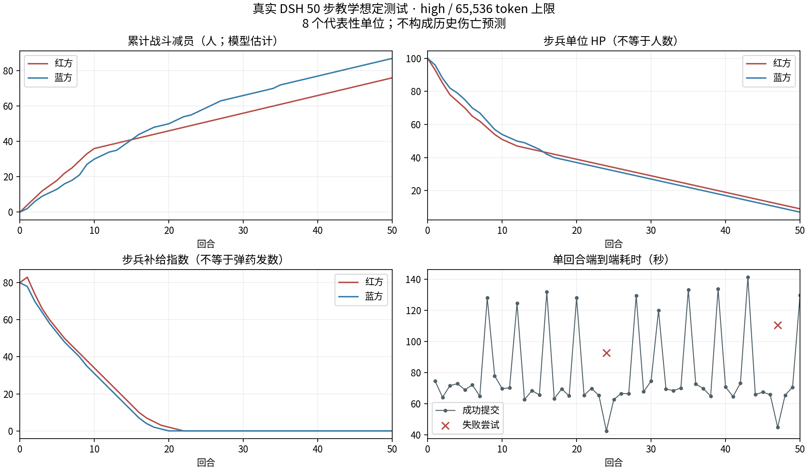

# 已保存战局删除与50步真实推演验收（2026-10-22）

**50步已完成，但不能判定所有输出合理。** 删除功能、程序时钟、状态持久化、人员/装备账本和原生轨迹通过；长测发生2次空正文失败，重试后完成。战报、射界与补给解释仍存在实质不一致。50步归因解读曾因上下文超限失败，本次已修复重复证据拼接并完成真实复测；模型解读本身仍需人工核验。

## 结果总览

| 项目 | 实测结果 |
|---|---|
| 真实推进 | 52次推进请求：50次成功、2次失败；同一战局从已保存状态续跑 |
| 模拟时间 | 1952-10-14 04:00 → 16:30，50×900秒=45,000秒 |
| 状态与轨迹 | 51份含开局快照、408条单位状态记录；8个编组全程保留；原生事件逐条核验通过 |
| 决策与交战 | 300条模型决策声明，229条交战事件；决策引用均指向存在的轨迹 |
| 人员最终账目 | 红方投入192、现有116、战斗减员76（39.6%）；蓝方投入192、现有105、战斗减员87（45.3%）；非战斗减员均0 |
| 装备最终账目 | 蓝方卡车3辆：2可用、1待修、0永久损失；其他记录装备未记损失。此项不构成装备毁伤模型验证 |
| 初始化耗时 | 43.73秒 |
| 成功回合耗时 | 平均79.74秒，中位数69.60秒，42.49–141.40秒 |
| 长程额外耗时 | 推进请求累计69.84分钟，包含两次失败；12次上下文压缩合计584.19秒 |
| 离线与界面 | 修复后25/25任务通过；SDK相关81/81测试通过；审计器7项故障注入检查通过；50步界面显示8单位/51轨迹、末步原生日志verified、390像素无页面溢出 |
| 最终判定 | 完成性通过；无故障稳定性未通过；语义有效性未通过 |

上述伤亡是本次模型生成的教学账本，不是真实战史数字或校准过的伤亡预测。没有HP归零或单位退场，本次长测不能替代这些路径的专项测试。

[逐回合人工核查表](qa/50步逐回合核查-2026-10-22.md) · [408条单位账本CSV](qa/50步单位账本-2026-10-22.csv)



## 删除功能

启动页 →「已保存战局」→ 每条战局右侧「删除」→ 确认。确认框显示想定、回合和战局编号；默认焦点在取消按钮。删除当前战局会清空当前界面及本地恢复指针。操作失败保留战局并允许重试，执行中禁止重复提交。后端拒绝忙碌时删除、未知编号及不合法来源；先删除持久化存档，再移除内存对象，避免磁盘失败后内存丢失。

删除的是已保存战局及恢复入口；原始 DSH 审计历史保留，界面明确告知这一点，并非彻底擦除所有日志。

接口回归、真实隔离 API 的浏览器验收覆盖取消/Escape、500失败恢复、删除另一战局、删除当前战局、重载不复活、重复提交保护和390像素窄屏。另修正长想定文字挤压顶部时钟和回合数的布局问题，摘要独立省略、窄屏分行。新版已本地打包安装，更新前后原有5个战局的状态、战报和轨迹逐项一致。未同步 GitHub。

## 测试设计与证据边界

- 上甘岭背景的**教学测试想定**，8个代表性单位：双方各步兵、炮兵、工兵、运输单位。每方初始192人；编制、位置、装备数是明确输入的测试条件，不是实际参战序列。
- 15分钟/步，真实 DSH 原生插件（Native工具模式，非PTC）和实际配置的模型服务，无固定响应或模型替身。启用裁决、史料检索、持久角色和领域工具；引擎保持 high、65,536 token 输出上限。
- 每步检查磁盘存档与内存一致、轨迹和原生事件可核验、时钟连续、名册唯一、人员/装备账本、坐标/射程、数据图层、决策引用。人工阅读全部公开战报并对照数值，机器检查不替代叙事判断。
- 第10步关闭并恢复运行时继续推演；第24、47步首次尝试发生正文为空的真实失败，拒收后分别从第23、46步重试。没有清空证据或从头重跑来隐藏失败。
- 本试验不验证真实伤亡预测、不证明九场战役均通过，也不覆盖23单位以上规模的性能或无明确输入数据时的自动补全质量。已提交轨迹记录get_observation 1次、evaluate_action 50次；本轮没有对50步历史执行成对模型fork，不将只读几何试算冒充该路径验证。

## 各类输出如何判定

| 输出 | 本次检查与判断 |
|---|---|
| 程序时钟、标题 | 逐步核对15分钟跨度和连续快照；正文另行检查。第29步标题11:15，正文却写“七点一刻”，说明自由文本没有完全受程序时钟约束。 |
| 名册与单兵/单位状态 | 检查唯一名称、连续保留、字段类型、数值范围和恢复后的状态一致性。本次粒度是8个编组，不能据此声称验证了每一名士兵的独立实体。 |
| 人员 | 逐单位校验累计投入=现有+战斗减员+非战斗减员，累计损失不倒退、无未声明增援。人数与HP分账，HP下降不能直接解释为死亡人数。 |
| 装备 | 分类校验累计投入=可用+待修+永久损失。第22步卡车3→可用2/待修1，与战报相符；没有受损的炮兵装备保持0损失是有效记录，并非空项。 |
| 士气、补给、战力 | 能连续记录指数，但不等于已建立独立粮、水、弹药、运量和疲劳模型。把补给指数7说成“弹药降到个位”存在量纲混淆。 |
| 交战、射程、射界 | 检查攻击者身份、位置、几何距离与显示射界；通过仅表示几何兼容，不代表命中、杀伤或高程通视经过计算。 |
| 地形与工事 | 参考高地点可保留，但同名“出发地”“坑道口”示意线会随输出改写。炮兵射界点被标为ridge，混淆地形与战术标注；工事施工也没有工程量账本。 |
| 补给节点与路线 | 显式节点、模型提供的折线路线与裁决推算的后方直线不是同一数据源，路线颜色不能直接作为裁决事实的证明。 |
| 战报与交战事件 | 多次出现“停火/不打”与同轮射击事件并存；第26步称背运线“今天第一次”被截断，却与此前战报冲突。完整字段不代表叙述自洽。 |
| 决策、来源与轨迹 | 检查行动、理由、单位身份和有效轨迹引用；理由是模型声明，不是可验证的内部因果证据。史料未覆盖的15分钟级损耗明确按模型估计处理。 |
| 转折点与归因 | 受控几何重算可展示位置变化对接触、截断、包围和退路的影响；没有确定性伤亡函数，不能输出真实胜率或胜负贡献比例。具体50步复验结果见下文。 |


## 跨输出不一致的实际覆盖

- 380次单位/时点比较发现声明补给节点与裁决推测后方相距超过100米；覆盖全部51个时点。另有37条路线状态与几何结果不同，分布在29个时点。二者评估的不是同一条路径，不能据此认定哪一个代表真实道路。
- 50个推进回合都改写了至少一个同名地形标注，共230次；其中有随炮位移动的射界点，也有本应明确身份的出发地、坑道口示意线。两处炮兵射界点全程被分类为ridge。
- 第42–50步共有9次射击超出显示扇面。例如T42方位246.6°，显示扇面为120°–240°；攻击距离仍符合最大射程。应同步射向或标明扇面发生变化。
- 30个回合内共有61条“回合开始补给为0仍射击”的事件；另有一次低补给位移略超过提示词减半上限（141米对约128–130米）。这是资源定义与规则执行的缺口，不能直接把指数0等同于没有任何随身弹药。
- 最终T50称红方工兵“满编”，实际为22/30人；普通复盘再次重复这个错误。战报“唯一变化”也漏掉双方继续减员与运输单位HP下降。
- 两支步兵后半程出现长段每回合固定减员1人的近线性曲线。账本能平衡，不代表这种损耗过程经过独立战斗模型或历史数据校准。

## 50步归因与复盘的补充验证

几何分析接口成功（2.25秒）：51条时间线、50组归因、398个位移试算，产生49个转折候选。145项状态转变全部来自补给（77项）和包围（68项）；49/50回合都有候选，说明当前筛选主要反映几何阈值翻转，尚不能有效筛出少数战略转折。

撤销位移试算成功，主战局、回合、战报与轨迹逐项不变。另将T50蓝方步兵的补给、士气设为100，全部8个汇总指标仍无变化：当前几何内核没有使用这两个数值重算这些指标，**不能解释为现实中的补给和士气没有影响**。

首次模型归因请求失败：原生错误为`CONTEXT_WINDOW_EXCEEDED`，输入375,088 token，加上65,536输出上限超过262,144上下文。输入本身已经超限，降低输出预算也无法解决。

本次新增`causal.explanation_evidence()`去除每个位移分支重复的范围、时钟、守卫和固定变量说明；守卫与时钟保留在对应回合，所有回合、300条决策、398个位移试算、状态变化和交互检查继续保留。零差分汇总指标省略并注明其含义；完整原始分析不变。实际提示词从885,101缩至311,518字符。

修复后真实调用成功：**129,246输入token、6,556输出token、88.93秒、8条假说**；high和65,536上限保持不变。新增回归验证50回合证据不丢失、状态差分及非零指标保持、输入对象不被修改。此次修复只影响只读解读输入，50步推演结果未重算。

这8条假说仍非全部可信：例如将差分中未变化的字段误读为字段缺失、把红方炮兵补给描述为单调上升并错误定位满值时点，以及声称互斥的战斗/非战斗减员不能相加。前两项属于长程证据解读错误；后者不能替代按既定账本口径计算总减员。有效轨迹引用只能证明记录存在，不能证明论断被记录支持。

普通复盘26.83秒返回，能正确计算步兵战斗减员率56.7%/57.5%和卡车可用率66.7%，但仍错误称红方工兵满编。修复了请求可运行性，不把模型语义质量宣称为已修复。

## 应优先处理的缺口

1. **统一补给数据源。** `gentactix/adjudicator.py` 的 `_rear_point()` 从友军位置猜测后方，未采用 `supply_nodes/supply_routes`。友军前移会改变“后方”，即使固定仓库未移动也可能改变截断结论。图层与裁决应共享经验证的节点/路线，并明确无道路数据时的回退方式。
2. **让正文服从已提交事实。** 时间、是否开火、累计损耗和“首次发生”应从结构化记录派生并校验，不能只依赖提示词。第15步“七个方向里七个被封，退路只剩一条”也错误改写了内核的24方向采样比例。
3. **补上资源与工事的状态约束。** 零补给仍持续射击的情况不能用单一指数解释；补给补充没有有限仓库存量、道路运量或弹药发数守恒。表面阵地/坑道的控制权也未成为独立的结构化变量。同名固定地形应保留身份与位置，施工变化应有明确事件。
4. **收紧原生工具参数契约。** 第1步位移试算传了 `unit_name`，执行器实际要求 `name`；8项位移全被列入unknown，却返回`ok:true`。应在插件JSON Schema与Python执行器两端验证；零项应用不能表现为成功试算。这次测试保留原代码行为以观察完整50步，未把此问题算作修复完成。
5. **完善空正文失败恢复。** 第24、47步原生会话均标记completed，但最后消息只有推理块，没有最终文本；输出分别仅157、278 token，不能归因于64k预算不够。两次均紧随上下文压缩，尚不足以单凭时序关系确定根因。当前拒收保护有效，但用户仍需重试。可考虑有限重试并保留失败轨迹，不能放宽可信输出门控。

这些是有效性缺口，不应被离线回归通过或一次50步完成掩盖。后续优化应先统一状态与规则，再提高叙述质量。

## 复现与文件

```bash
/home/spikebai/anaconda3/envs/wargame/bin/python tools/live_campaign_soak.py \
  --live --turns 50 --scenario-file <UTF-8想定文件> --out <新的隔离目录>
# 中断后：同一目录增加 --resume，保留失败记录。
/home/spikebai/anaconda3/envs/wargame/bin/python tools/qa/audit_outputs.py \
  --live-dir <隔离目录> --out <检查结果.json>
/home/spikebai/anaconda3/envs/wargame/bin/python tools/qa/audit_campaign.py \
  --export <隔离目录/export.json> --dsh-home <隔离目录/dsh> \
  --out <结构检查.json> --turns 50
/home/spikebai/anaconda3/envs/wargame/bin/python verify_campaign_outputs.py
```

本机证据目录：`.cache/qa/soak-50-20261022/`。其中`live/`保存真实响应、逐步检查点与原生轨迹，`manual-review.json`保存人工核查说明，`output-audit.json`保存逐字段检查，删除界面截图与日志单独保存。原生私有日志不进入版本库；报告和公开账本不包含密钥或模型内部推理。
