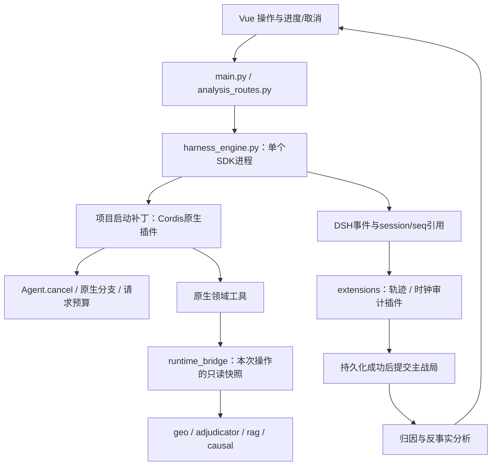

# 因果分析、反事实与 DSH 插件架构

实现与验收日期：2026-10-21。适用入口为 `backend/` + Vue/Electron。原 Streamlit 入口仍使用旧模型引擎，没有冒称已接入原生 DSH 控制。

2026-10-22更新：`sim_clock.py` 已接入两个入口与反事实候选验收，程序持有累计时间，模糊历史时间使用带原点的T+标签；候选时间不匹配即拒收，已复测真实15分钟推进。geo-3将 `contact_km` 纳入接触公式；年份门控已收窄。下文2026-10-21的模糊时间缺口保留为历史记录。菜单现可修改接口与角色预算，配置使用根目录加密文件，详见[桌面说明](桌面启动与配置.md)与[本轮验收](桌面与配置验收-2026-10-22.md)。

## 当前模式与判断

安装版本为 `deepseek-harness-sdk` / runtime-bin **0.2.1rc2**，实际模型为配置的 `qwen3.8-flash-next-iq3_s`。DSH 是运行时品牌，不代表使用 DeepSeek 官方模型。

| 项目 | 修改前 | 本次实现 |
|---|---|---|
| Profile | `sdk-minimal` | 保留，叠加项目级 Cordis 插件 |
| 工具模式 | 普通 JSON；智能体用应用层 JSON 循环 | 智能体可选原生 Native 领域工具；保留 JSON 兼容模式 |
| PTC | 未使用 | 仍未使用；实际请求暴露领域工具名，不是 `run_code` |
| 连续记忆 | 环境开关或工具模式启用 | 新桌面会话默认连续角色记忆，可单局关闭；轨迹仍记录 |
| 取消 | 模型调用结束后的步界取消 | 原生 `Agent.cancel` 可取消在途请求，控制通道不取得模型锁 |
| 分支 | Python `deepcopy` 试算 | 保留几何试算，并增加原生 DSH 事件前缀分支与成对模型重演 |
| 输出预算 | 全局已设置16384，并非None | 按角色在 `agent/request` 钩子中设置；实际请求事件可核对 |
| 轨迹 | 提取部分用量和结束状态 | 事件序号、工具调用结果、公开决策摘要、前后态势、程序守卫和分支谱系关联 |

**Native 适合当前任务。** 观察、检索、位移和反事实均为有固定输入输出的领域工具，Python 内核负责可复现计算。PTC 允许模型编写程序批量调用工具，当前不需要额外的代码执行面。以后引入大型批量试验时可独立评估 PTC，不把切换工具呈现方式当成推理质量保证。

**必须区分核心能力与 SDK 暴露面。** 当前安装的 runtime 对公开 `client.request('session/cancel', ...)`、`'session/fork'` 都返回 `unknown DeepSeek Harness SDK runtime method`。这已实际探测，未调用模型。直接照搬同名 Web/内部接口不能生效。本项目插件通过注入的原生 Agent 服务实现取消与分支，Python 通过独立的本机控制通道访问。没有修改 SDK 包、全局 `~/.dsh` 或生成的 `sdk-minimal` profile。

## 拆分后的层次



- `plugins/dsh-gentactix/index.mjs`：真实 Cordis 插件，无额外 npm 依赖。注册 `get_observation`、`retrieve_history`、`evaluate_action`、`inspect_trajectory`、`evaluate_counterfactual`，接入 `agent/request`、`agent/pre-step`、`session/event`；提供原生取消和原生分支控制。
- `plugins/dsh-gentactix/launch.patch.yml`：每次启动叠加，注销 shell、图像及目录工具，挂载项目插件。模型 persona 仍约束行为，但不再仅靠文字禁止无关工具。
- `backend/runtime_bridge.py`：本机操作上下文桥接。每个运行 ID 绑定脱离主战局的快照，原生工具复用现有只读执行器。控制通道独立于 `_OP_LOCK` 和模型调用锁。
- `backend/extensions.py`、`plugins/runtime.json`：可信应用插件的登记与事件接口。当前启用轨迹持久化、时钟审计、因果归因；钩子获得副本。必需的 `before_commit` 持久化失败时拒收回合，原战局不动。
- `gentactix/causal.py`：不需要第三方依赖的只读计算模块。`analysis_routes.py` 负责分析 API，`CausalPanel.vue` 负责交互和证据呈现。

主战局提交仍由 `main.py` 的名单、计数和候选提交管线控制；不把这些不变量交给模型工具任意替换。

## 因果分析具体计算了什么

### 决策与状态证据

每次成功开局/推进保存决策前后完整快照、回合与参数、实际输入、名单回填/数值/位移守卫及 DSH 运行记录。模型可返回 `decisions`：方别、已有单位、命令、简短依据和预期影响。该字段标为“模型声明”，关联到实际 assistant 事件序号；遗漏时不从战果反推或补造意图。

公开轨迹只保存执行事实和公开摘要，不展示原始内部 reasoning。原生工具调用及结果由 DSH 记录；兼容 JSON 协议的执行另标 `application_json_protocol`，不会冒充原生 `tool/call`。

### 转折候选与归因

程序比较回合前后 `can_contact`、几何补给截断、包围和退路状态。按变化项数排列**状态转折候选**，不是自动判定战略逆转。

位移归因固定其他单位终态、环境和参数，逐项把一个单位的位置恢复到决策前，再重算同一几何内核。输出哪些单位状态变化、双方指标差值。每回合最多覆盖12个位移，前4个有影响位移另做两两联合撤销，暴露非加性；未覆盖数明确返回。不会把影响项数换成“胜负贡献百分比”。

这属于模型内的受控几何敏感性分析。它没有新增伤亡、炮击命中、道路运量、工事或战役胜负结构方程，不能据此识别真实历史因果效应。未开启正式裁决的战局，本页会注明这些是独立试算。

### 成对原生反事实

选择 T+n 决策后，找到 **T+n−1 对应的已完成 DSH 事件边界**。插件用公开 `AgentRegistry.create` 的 seed/父会话接口，将完全相同的精确前缀分别交给对照与干预子 Agent；保留原生 `parentSession` 和 inherited 标记。当前事实回合的输出不进入分支输入，工具也只能读取决策前快照和更早轨迹。

对照遵守原任务，干预接受明确替代命令。每组两次模型调用，允许1—3组。两个候选均独立运行名单、计数、坐标、位移和钟点检查，失败或时间无法核验的样本不可采纳。结果与事件来源保存为独立分析产物，**不覆盖主战局**。

未控制服务端采样随机性；史料与模型既有知识也可能引入结局先验。成对差异是推演证据，不输出伪造的因果置信区间或胜率。归因解读另外标为模型假说，必须引用存在的轨迹 ID，并列替代解释和局限；引用不存在的证据会被拒收。

## 使用与扩展

桌面开局后至少推进一轮，打开“因果与轨迹”：查看转折候选、撤销位移试算、输入替代命令运行成对分支、生成归因解读、展开并核验 DSH 日志。进行中的操作显示步骤/用量并提供取消按钮。

主要接口：`GET/POST /api/sessions/{id}/analysis`、`POST .../counterfactual`、`GET .../traces/{turn}`、`GET .../progress`、`POST .../cancel`、`GET /api/runtime/plugins`。JSON 导出包含轨迹、分析与分支；轨迹另保存在项目 `.cache/trajectories/{id}/epoch-*`。这不等于重启后自动恢复内存战局。

分角色配置：`GENTACTIX_{ENGINE|STRATEGIST|CHAT|CAUSAL|COUNTERFACTUAL}_MAX_TOKENS`，默认分别16384、8192、2048、4096、16384；`..._REASONING_EFFORT` 留空时保留适配器默认。不是所有兼容服务都支持同样 effort 档位，不能承诺“零风险”。`GENTACTIX_MAX_RUNTIME_STEPS` 默认8，原生工具预算16次。

新增应用观测插件：在 `extensions.py` 的 `_hooks` 登记回调，再加入 `plugins/runtime.json`。新增 Cordis 插件：使用 `export const name/inject`、`apply(ctx)` 与 DSH 服务/事件接口，通过额外启动补丁加载。例如：

```bash
export GENTACTIX_DSH_PATCHES='["/absolute/path/observer.patch.yml"]'
conda run -n wargame python -m uvicorn backend.main:app --host 127.0.0.1 --port 8700
```

插件和 profile 变更需要新后端进程。既有8700进程包含内存战局，本轮没有重启它；先导出需要保留的战局再重启，刷新前端不能更新 Python 运行时。

Web 搜索/抓取、自动角色质询与 `subagentchat`、Office、浏览器及 PTC 目前没有挂载。`sdk-minimal` 不包含完整 Web 服务，联网采集还需要明确 provider 和可见的来源/缓存策略；“实时情报”叙事提示依然不能算联网搜索。原生分支提供父子 Agent 谱系，但不冒称已实现自主多角色委派。

## 验收证据

离线：全量20/20任务；wargame 后端25/25、Harness27/27、领域工具12/12；因果模块9/9、插件/API回归13/13。Vue类型检查与生产构建通过。SDK相关用例在旧 `.venv` 跳过，并在wargame补跑。

真实 DSH/Qwen：原生工具实际调用观察与位移试算；在途取消约0.005秒结束为 `aborted`。完整应用初始化68.22秒、原生推进83.44秒、归因解读33.22秒、成对分支160.83秒；记录6条决策声明、5个位移归因和1个转折候选。分支前后主态势、回合和战报相同。

另以真实在途问答验证主 API：取消请求约0.013秒返回200，生成请求返回409，线程停止，战局和消息列表保持原样。核验两臂原生会话文件：共同父边界为序号13，继承事件与父会话精确前缀一致，均有原生 inherited 标记；各自新增事件分别24/24、30/30落盘。以上证据分别保存在 `api-cancel-live.json`、`native-lineage-reaudit.json`。

首次核验因异步刷盘为20/23个事件，运行时刷盘后对同一真实轨迹复核为23/23；不将 `partial` 写成 verified。真实响应使用“凌晨4时/4时15分”，最初只识别冒号格式的时钟审计误标unknown；补充中文时分后，以原始响应离线复核，两臂均推进15分钟且无位移/数值警告。这是同一数据复核，不冒充额外真实模型重复试验。模糊“拂晓前”的时钟约束仍未解决，审计会标unknown，正式推演没有新增确定性时钟。

浏览器以固定响应承接真实快照，验证2条回合轨迹、5个撤销按钮、反事实/归因展示、证据链接、日志核验、502恢复和取消；1440×1000与390×844均无JavaScript异常，窄屏页面宽度390。固定响应界面测试与上述真实模型测试分别记录。全部证据在忽略目录 `.cache/qa/causal-20261021/`。

## DSH 一手资料

- [Python SDK指南](https://github.com/deepseek-ai/deepseek-harness/blob/master/docs/user/guide/python-sdk.md)：profile、隔离home、启动patch与JSONL持久化；以本机实际安装版本及探测结果为实施依据。
- [Session模型与分支契约](https://github.com/deepseek-ai/deepseek-harness/blob/master/docs/subsystems/session.md)：事件源、父子谱系、稳定前缀和seed接口。
- [工具运行时](https://github.com/deepseek-ai/deepseek-harness/blob/master/docs/subsystems/tools.md)：原生工具注册、执行事件与PTC区别。
- [SDK服务端公开方法实现](https://github.com/deepseek-ai/deepseek-harness/blob/master/packages/sdk/server/src/server.ts)：不能由核心能力推定SDK RPC方法已暴露。
